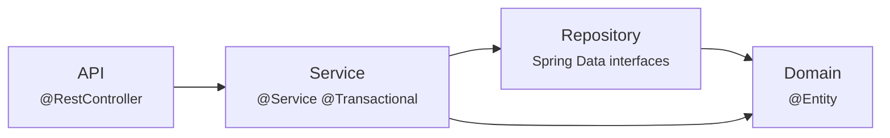

# 02 — Architecture

## Shape

A **modular monolith**: one deployable unit, one database, feature packages with
enforced boundaries.

Microservices were considered and rejected. For an application of this size they
would convert in-process method calls into network calls that can fail
independently, turn a single ACID transaction into a distributed saga, and
multiply the operational surface — all to solve a scaling problem that does not
exist here. The module boundaries below are real; if one ever needed to become a
service, the seam is already drawn.

```mermaid
graph TB
    Client["Client<br/>curl · Swagger UI · any HTTP client"]

    subgraph FinSight["FinSight application"]
        direction TB
        Filters["Servlet filters<br/>RequestLoggingFilter → JwtAuthenticationFilter"]
        Controllers["Controllers<br/>bind · validate · delegate · shape response"]
        Services["Services<br/>business rules · transaction boundaries"]
        Repos["Repositories<br/>Spring Data JPA"]
        Domain["Domain entities<br/>invariants · factories"]
    end

    PG[("PostgreSQL 16<br/>system of record")]
    Redis[("Redis<br/>report cache")]
    Kafka[["Kafka<br/>import events"]]

    Client -->|HTTPS| Filters
    Filters --> Controllers
    Controllers --> Services
    Services --> Repos
    Services -.->|@Cacheable / evict| Redis
    Repos --> Domain
    Repos --> PG

    Services -->|outbox row, same TX| PG
    PG -->|polled| Publisher["OutboxPublisher<br/>@Scheduled"]
    Publisher --> Kafka
    Kafka --> Consumer["ImportEventConsumer"]
    Consumer --> Services

    style PG fill:#336791,color:#fff
    style Redis fill:#d82c20,color:#fff
    style Kafka fill:#231f20,color:#fff
```

Note the direction of the event path: the service writes a **row**, not a
message. Nothing in the request path talks to Kafka. That is what makes the write
atomic — see [08](08-KAFKA-AND-ASYNCHRONOUS-PROCESSING.md).

---

## Layers

Four layers, each with one job.



| Layer | Does | Does not |
|---|---|---|
| **API** | Bind and validate input, delegate, choose status code and headers | Business rules, repository access, transaction management |
| **Service** | Enforce rules, define transaction boundaries, orchestrate, invalidate caches | HTTP concerns, SQL |
| **Repository** | Declare queries | Decisions |
| **Domain** | Hold state, protect invariants, provide factories | Know about HTTP, Spring, or persistence strategy |

### A controller, in full

```java
@PostMapping
public ResponseEntity<TransactionResponse> create(
        @AuthenticationPrincipal UserPrincipal principal,
        @Valid @RequestBody TransactionRequest request) {

    TransactionResponse created = transactionService.create(principal.getId(), request);
    return ResponseEntity
            .created(UriComponentsBuilder.fromPath("/api/v1/transactions/{id}")
                    .buildAndExpand(created.id()).toUri())
            .body(created);
}
```

Three lines of logic: who is asking, do the work, shape the answer. The owner
comes from `@AuthenticationPrincipal` — from the *verified token* — never from
the request body or a query parameter. That single habit is what prevents IDOR
across the whole application.

---

## Modules

```
com.finsight
├── auth           ─┐
├── user            │  identity
├── category       ─┐
├── transaction     │  the core domain
├── budget          │
├── report         ─┘
├── imports         ─┐
├── messaging        │  asynchronous pipeline
├── outbox          ─┘
├── common           shared kernel
└── config           Spring wiring
```

### Dependency rules

- `common` and `config` are depended on by everything and depend on nothing.
- Feature modules depend **inward** (on `common`) and **sideways** on a small
  number of peers, never upward into `api`.
- `transaction` does not know `report` exists. `report` reads transactions.
- `imports` depends on `transaction` and `category`; neither knows about imports
  except through the nullable `import_job_id` column.

The one place a feature module reaches across deliberately is
`BudgetService → ReportRepository`: budget-versus-actual must measure spend using
*the same query the summary report uses*, so the two endpoints can never disagree
about how much was spent in a month. Duplicating the aggregation would be the
kind of drift nobody notices until a user reports that two screens show different
numbers.

### Responsibilities

| Module | Owns |
|---|---|
| `auth` | Registration, login, refresh, JWT issuing/verification, the security filter, 401/403 bodies |
| `user` | The `User` entity and its repository |
| `category` | System and user categories, visibility rules, type agreement |
| `transaction` | The core entity, dynamic filtering, CRUD, user-data isolation |
| `budget` | Monthly caps, budget-versus-actual evaluation, status thresholds |
| `report` | Aggregate queries, densification, percentage shares, caching |
| `imports` | Upload validation, CSV parsing, import jobs, row errors, row application |
| `messaging` | Topic names, event schema, consumer, idempotency ledger |
| `outbox` | The outbox table, recorder, publisher |
| `common` | `ApiError`, exceptions, `PageResponse`, `Money`, `Hashes`, `DateRanges`, `UserCacheEvictor`, `AuditableEntity` |
| `config` | `SecurityConfig`, `RedisCacheConfig`, `KafkaConfig`, `OpenApiConfig`, `@ConfigurationProperties` records |

---

## Dependency injection

Constructor injection, everywhere, with no exceptions.

```java
@Service
public class TransactionService {

    private final TransactionRepository transactionRepository;
    private final CategoryService categoryService;
    private final UserCacheEvictor cacheEvictor;

    public TransactionService(TransactionRepository transactionRepository,
                              CategoryService categoryService,
                              UserCacheEvictor cacheEvictor) { … }
}
```

With one constructor, Spring injects it without `@Autowired`. Three consequences:

1. **Fields are `final`** — genuinely immutable after construction.
2. **Dependencies are visible** — a constructor with nine parameters announces
   that the class is doing too much. Field injection hides that.
3. **Unit tests use `new`** — no Spring context needed, which is why
   `TransactionServiceTest` runs in milliseconds.

Field injection (`@Autowired private Foo foo;`) is used nowhere. It cannot be
`final`, it hides the dependency count, and it forces reflection or a container
in tests.

### Spring annotations in use

| Annotation | Effect |
|---|---|
| `@SpringBootApplication` | `@Configuration` + `@EnableAutoConfiguration` + `@ComponentScan` from `com.finsight` down |
| `@RestController` | `@Controller` + `@ResponseBody`; every return value is serialised |
| `@Service`, `@Component`, `@Repository` | Stereotypes; component scanning registers them as beans |
| `@Configuration` + `@Bean` | Explicit bean definitions for third-party types |
| `@ConfigurationProperties` | Binds a configuration subtree onto a record |
| `@Transactional` | AOP proxy opens/commits/rolls back around the method |
| `@Valid` | Triggers Bean Validation on the bound argument |
| `@Cacheable` | Proxy checks the cache before invoking the method |
| `@Scheduled` | Registers the method with the task scheduler |
| `@KafkaListener` | Binds the method to a topic through a listener container |
| `@EntityGraph` | Declares a fetch plan, avoiding N+1 |
| `@AuthenticationPrincipal` | Resolves the authenticated principal into a parameter |

---

## Transactions

Boundaries sit on **service methods** — the unit of business work, therefore the
unit of atomicity.

```java
@Transactional
public ImportJobResponse upload(Long userId, MultipartFile file) {
    …
    ImportJob job = jobRepository.save(ImportJob.accepted(…));   // ┐
    payloadRepository.save(new ImportPayload(job.getId(), …));   // ├ one transaction
    outboxRecorder.recordImportRequested(job.getId(), …);        // ┘
}
```

All three commit together or none do.

`@Transactional` works through an AOP proxy, which has one consequence worth
internalising: **a self-invocation does not go through the proxy**. Calling
`this.someTransactionalMethod()` from inside the same class bypasses the
annotation entirely. Where that matters here, the call crosses a bean boundary
(`ImportService` → `ImportProcessor`), so the proxy is involved.

Reads are `@Transactional(readOnly = true)`: Hibernate skips dirty-check
bookkeeping and the driver flags the transaction read-only to PostgreSQL.

### Propagation, where it is used deliberately

| Where | Propagation | Why |
|---|---|---|
| `OutboxRecorder.recordImportRequested` | `MANDATORY` | **Refuses to run without a caller's transaction.** The whole point of an outbox is that the event and the business change commit together; recording in its own transaction would silently reintroduce the dual write. Making it a loud failure beats discovering it during an incident. |
| `OutboxPublisher.publishPending` | `REQUIRES_NEW` | The scheduled pass owns its own transaction, independent of the scheduler thread. |
| Everything else | `REQUIRED` (default) | Join the caller's transaction or start one. |

---

## Concurrency

**Optimistic locking by default.** Every mutable entity extends
`AuditableEntity`, which carries `@Version`. Hibernate appends `AND version = ?`
to each UPDATE; zero matching rows means someone else changed it first, and
`GlobalExceptionHandler` turns the resulting exception into **409 Conflict**.

This is the right default for a web application. A pessimistic row lock held
across a user's think-time would serialise unrelated requests, and the conflict
rate here is low — two requests editing the same transaction at the same instant
is rare, while two requests editing *different* transactions is the normal case.

**Pessimistic locking is available but barely used.**
`findByIdAndUserIdForUpdate` issues `SELECT … FOR UPDATE` for the rare
read-modify-write that must not interleave.

**`FOR UPDATE SKIP LOCKED`** in the outbox poller is the one place a lock is
load-bearing. It lets several application instances poll the same table
concurrently: each locks the rows it claims and steps over rows another instance
already holds. Without `SKIP LOCKED` they would serialise; without `FOR UPDATE`
they would all publish the same events.

**Budget spend is measured, never accumulated.** There is no "spent so far"
counter to race on. Every read recomputes from the month's transactions. That
costs one indexed aggregate query and eliminates an entire class of bugs — a
counter would need adjusting on create, update (where amount, date *or* category
may change), delete, category archival and import rollback, and any missed path
corrupts it silently.

---

## Error handling

One shape, everywhere:

```json
{
  "timestamp": "2026-10-14T09:31:22.481Z",
  "status": 400,
  "code": "VALIDATION_FAILED",
  "message": "One or more fields are invalid",
  "path": "/api/v1/transactions",
  "traceId": "0f6b1c2d9a3e4f58",
  "fieldErrors": [{ "field": "amount", "rejectedValue": "-10", "message": "must be greater than 0" }]
}
```

`GlobalExceptionHandler` (`@RestControllerAdvice`) maps every exception. The
`ErrorCode` enum carries its own HTTP status, so status selection is a property of
the error rather than an if-else chain.

**Exceptions thrown inside the security filter chain never reach it** — filters
run before the `DispatcherServlet`, so nothing they throw is visible to a
`@RestControllerAdvice`. That is why `RestAuthenticationEntryPoint` and
`RestAccessDeniedHandler` exist and deliberately emit the identical body. Without
them, a 401 would be Spring Security's default empty response: a different shape
from every other error the API returns.

Stack traces never appear in a response. The caller gets a `traceId` to quote;
the detail stays in the log under the same id.

---

## Observability

| Signal | Where |
|---|---|
| Liveness / readiness | `/actuator/health/liveness`, `/actuator/health/readiness` |
| Metrics | `/actuator/prometheus` |
| Structured logs | Console, with `traceId` and `userId` in the MDC |

Custom meters:

| Meter | Type | Meaning |
|---|---|---|
| `finsight.outbox.pending` | gauge | Unpublished events. Rising = publication is behind. |
| `finsight.outbox.parked` | gauge | Events that exhausted their retries. **Non-zero needs a human.** |
| `finsight.outbox.published` | counter | Broker-acknowledged publishes |
| `finsight.import.rows{outcome}` | counter | `imported` / `duplicate` / `failed` |
| `finsight.kafka.events{outcome}` | counter | `processed` / `skipped_duplicate` |

`skipped_duplicate` is the interesting one: it is direct evidence of
at-least-once delivery happening in production, and of the idempotency ledger
absorbing it.

Request logging records method, path, status and duration — and deliberately not
bodies, query strings or headers, because those carry passwords, financial detail
and live bearer tokens.
