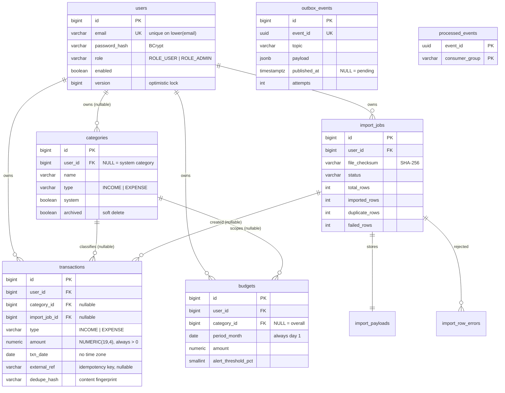

# 03 — Database Design

PostgreSQL 16. Schema owned entirely by Flyway (`V1`–`V7` in
`src/main/resources/db/migration/`). Hibernate runs with
`ddl-auto=validate` and never creates or alters anything.

## Entity relationships



---

## Cross-cutting decisions

### Surrogate keys are `BIGINT` identity

Eight bytes, sequential, excellent B-tree locality. UUIDv4 would cost 16 bytes
and scatter inserts across the index, causing page splits and a larger working
set — for the benefit of making ids unguessable. That benefit is moot here,
because **no endpoint ever returns another user's id**: ownership is in the
`WHERE` clause and a foreign id is simply "not found". If ids were ever exposed
across a trust boundary, UUIDv7 would be the move — time-ordered, so it keeps the
locality.

### Money is `NUMERIC(19,4)`

Exact decimal. `FLOAT`/`DOUBLE` cannot represent 0.1 exactly and the error
compounds across a year of summed rows. Four fractional digits leave room for
sub-paisa intermediate values; presentation rounds to two.

`amount` is always a **positive magnitude**; `type` carries the direction. This
makes `CHECK (amount > 0)` possible and turns aggregation into
`SUM(CASE WHEN type = 'INCOME' THEN amount END)` rather than trusting every
writer to have got a sign right.

### Timestamps are `TIMESTAMPTZ`, `txn_date` is `DATE`

`created_at` / `updated_at` are instants: `TIMESTAMPTZ` ↔ `java.time.Instant`,
with `hibernate.jdbc.time_zone=UTC`.

`txn_date` is deliberately **not** an instant. A purchase happens on a calendar
day from the user's point of view. Storing an instant would make "March spending"
depend on the reader's time zone and put a transaction made at 23:30 IST on 31
March into April for a UTC reader. As a `DATE`, `BETWEEN '2026-03-01' AND
'2026-03-31'` means exactly what it looks like, for everyone.

### Enums stored as `VARCHAR` with a `CHECK`

`@Enumerated(EnumType.STRING)`, never `ORDINAL`. An ordinal mapping stores the
enum's *position*, so inserting a constant in the middle of the enum silently
re-labels every existing row. A `CHECK` constraint keeps the database honest
about the permitted values; a native PostgreSQL `ENUM` type was rejected because
adding a value to one requires `ALTER TYPE`, which is awkward in a migration and
in a rollback.

### Every mutable table carries `version`

Backs `@Version`. Hibernate appends `AND version = ?` to each UPDATE, so a lost
update becomes a 409 instead of one write silently overwriting another.

---

## Tables

### `users` (V1)

```sql
CREATE TABLE users (
    id            BIGINT       GENERATED BY DEFAULT AS IDENTITY PRIMARY KEY,
    email         VARCHAR(254) NOT NULL,
    password_hash VARCHAR(100) NOT NULL,
    full_name     VARCHAR(120) NOT NULL,
    role          VARCHAR(20)  NOT NULL DEFAULT 'ROLE_USER',
    enabled       BOOLEAN      NOT NULL DEFAULT TRUE,
    created_at    TIMESTAMPTZ  NOT NULL DEFAULT now(),
    updated_at    TIMESTAMPTZ  NOT NULL DEFAULT now(),
    version       BIGINT       NOT NULL DEFAULT 0,
    CONSTRAINT ck_users_role  CHECK (role IN ('ROLE_USER', 'ROLE_ADMIN')),
    CONSTRAINT ck_users_email CHECK (position('@' IN email) > 1)
);

CREATE UNIQUE INDEX uq_users_email_lower ON users (lower(email));
```

A **functional index** rather than the `citext` extension: `CREATE EXTENSION`
needs privileges the least-privilege application role deliberately does not have.
`UserRepository` lower-cases in the query so the index is used rather than
scanned around:

```java
@Query("SELECT u FROM User u WHERE lower(u.email) = lower(:email)")
Optional<User> findByEmailIgnoreCase(@Param("email") String email);
```

`VARCHAR(254)` is the RFC 5321 maximum. `VARCHAR(100)` fits a BCrypt hash (60
chars) with room for a future `DelegatingPasswordEncoder` prefix.

### `categories` (V2)

Two flavours in one table:

- **System** — `user_id IS NULL`, `system = true`. Seeded by V7, visible to all,
  editable by none.
- **User** — `user_id NOT NULL`, `system = false`.

```sql
CONSTRAINT ck_categories_system_ownership CHECK (
    (system IS TRUE AND user_id IS NULL) OR (system IS FALSE AND user_id IS NOT NULL)
);

CREATE UNIQUE INDEX uq_categories_user_name
    ON categories (user_id, lower(name)) WHERE user_id IS NOT NULL;

CREATE UNIQUE INDEX uq_categories_system_name
    ON categories (lower(name)) WHERE user_id IS NULL;
```

**Why two partial indexes rather than one `UNIQUE (user_id, lower(name))`:**
SQL treats NULLs as distinct, so a single constraint would happily allow two
system categories both named "Groceries". The partial indexes separate the two
namespaces explicitly.

`archived` is a soft delete. A hard delete would set `category_id` to NULL on
every transaction that referenced it (per `ON DELETE SET NULL`), silently
rewriting the user's spending history. Archiving keeps history intact and merely
stops the category being offered for new records.

### `transactions` (V4) — the core table

```sql
CREATE TABLE transactions (
    id            BIGINT        GENERATED BY DEFAULT AS IDENTITY PRIMARY KEY,
    user_id       BIGINT        NOT NULL REFERENCES users (id) ON DELETE CASCADE,
    category_id   BIGINT        NULL REFERENCES categories (id) ON DELETE SET NULL,
    import_job_id BIGINT        NULL REFERENCES import_jobs (id) ON DELETE SET NULL,
    type          VARCHAR(10)   NOT NULL,
    amount        NUMERIC(19,4) NOT NULL,
    currency      VARCHAR(3)    NOT NULL DEFAULT 'INR',
    txn_date      DATE          NOT NULL,
    description   VARCHAR(255)  NOT NULL,
    merchant      VARCHAR(120)  NULL,
    notes         VARCHAR(500)  NULL,
    source        VARCHAR(20)   NOT NULL DEFAULT 'MANUAL',
    external_ref  VARCHAR(100)  NULL,
    dedupe_hash   VARCHAR(64)   NOT NULL,
    …
    CONSTRAINT ck_transactions_amount CHECK (amount > 0)
);
```

**Foreign-key behaviours, each chosen deliberately:**

| FK | Action | Why |
|---|---|---|
| `user_id` | `ON DELETE CASCADE` | Deleting an account must remove its data. |
| `category_id` | `ON DELETE SET NULL` | A deleted category must not delete a year of spending. The row survives as "Uncategorized". |
| `import_job_id` | `ON DELETE SET NULL` | Purging old import history must not delete the transactions it produced. |

**`external_ref` and `dedupe_hash` are two different ideas**, and conflating them
is the most common mistake in this area:

| | `external_ref` | `dedupe_hash` |
|---|---|---|
| Purpose | **Idempotency key** | **Heuristic fingerprint** |
| Value | `sha256(fileChecksum + ':' + rowNumber)` | `sha256` of normalised date, type, amount, description, merchant |
| Unique? | **Yes**, per user, partial | **No**, deliberately |
| For manual entries | `NULL` | always set |
| Answers | "Have I already applied this exact row of this exact file?" | "Does this look like something already recorded?" |

Making `dedupe_hash` unique would reject two identical coffees on the same day —
legitimate data. Making `external_ref` non-unique would let a redelivered Kafka
message insert every row twice. Both are needed, and they are not the same thing.

### Indexes on `transactions`

```sql
CREATE UNIQUE INDEX uq_transactions_user_external_ref
    ON transactions (user_id, external_ref) WHERE external_ref IS NOT NULL;

CREATE INDEX idx_transactions_user_date          ON transactions (user_id, txn_date DESC, id DESC);
CREATE INDEX idx_transactions_user_category_date ON transactions (user_id, category_id, txn_date);
CREATE INDEX idx_transactions_user_type_date     ON transactions (user_id, type, txn_date);
CREATE INDEX idx_transactions_user_dedupe        ON transactions (user_id, dedupe_hash);
CREATE INDEX idx_transactions_import_job         ON transactions (import_job_id) WHERE import_job_id IS NOT NULL;
```

Every one exists for a named query, not on principle:

| Index | Serves |
|---|---|
| `uq_…_external_ref` | The idempotency guarantee itself. Partial, so the many manual rows with `NULL` cost nothing. |
| `user_date` | `GET /transactions` default listing, and every date-ranged report. `id DESC` is the tiebreaker that makes paging deterministic when several rows share a date. |
| `user_category_date` | Category filters and `GET /reports/categories` |
| `user_type_date` | Income/expense totals in `GET /reports/summary` |
| `user_dedupe` | Duplicate *detection* lookups |
| `import_job` | "Show me what this import created" / rollback. Partial. |

**`user_id` leads every one.** This is not incidental: because the application
can only ever query within one user, a composite index starting with `user_id`
turns every access path into a narrow range scan over that user's slice.

Column order within a composite index follows the standard rule: equality
predicates first, then the range/sort column. `(user_id, txn_date DESC, id DESC)`
lets PostgreSQL seek straight to the user and walk the dates in order, with no
sort step.

#### Reading a plan

```sql
EXPLAIN (ANALYZE, BUFFERS)
SELECT * FROM transactions
WHERE user_id = 1 AND txn_date BETWEEN '2026-03-01' AND '2026-03-31'
ORDER BY txn_date DESC, id DESC LIMIT 20;
```

Expect `Index Scan using idx_transactions_user_date`. A `Seq Scan` on a table of
any size means the index is missing or the planner's statistics are stale — run
`ANALYZE transactions`. On a very small table a sequential scan is correct and
not a problem.

### `budgets` (V5)

```sql
CONSTRAINT ck_budgets_period CHECK (date_trunc('month', period_month) = period_month)
```

A budget covers a whole month, so `period_month` always stores day 1. The CHECK
makes that invariant unbreakable from any client, including a direct `psql`
session — which an application-layer check alone would not.

Again two partial unique indexes, for the same NULL-distinctness reason as
categories: one overall budget per user per month, one per category per month.

### `import_jobs`, `import_payloads`, `import_row_errors` (V3)

`import_payloads` is a separate table with a shared primary key so `import_jobs`
— which is polled for status and updated several times per job — stays narrow.
PostgreSQL would TOAST a large `TEXT` column out of line anyway, but separating
it also keeps the payload out of every status query's result set.

Storing uploaded bytes in the database is a **deliberate simplification**: it
makes the job, the payload and the outbox event a single atomic write with no
second system to keep consistent. The 5 MiB upload cap is what makes it
acceptable. At real scale the payload belongs in object storage with a key here.

`import_row_errors` stores one row per rejected line, so a user whose 900-row
file had 12 problems sees exactly which twelve and why — rather than "12 rows
failed".

### `outbox_events` and `processed_events` (V6)

```sql
CREATE INDEX idx_outbox_unpublished
    ON outbox_events (created_at, id) WHERE published_at IS NULL;
```

A **partial** index on the poller's only predicate. It stays tiny even after
millions of rows have been published, because published rows are not in it.

`payload` is `jsonb`, mapped from a Java `String` with
`@JdbcTypeCode(SqlTypes.JSON)`. The database validates it as JSON and it stays
queryable, rather than being an opaque blob.

`processed_events` has the composite primary key `(event_id, consumer_group)` —
not `event_id` alone, because different consumer groups are independent
subscribers and each must get its own chance to process the event.

---

## Useful queries

```sql
-- Index usage. idx_scan = 0 on a busy table means the index is dead weight.
SELECT relname, indexrelname, idx_scan, pg_size_pretty(pg_relation_size(indexrelid))
FROM pg_stat_user_indexes WHERE schemaname = 'public' ORDER BY idx_scan;

-- Table sizes
SELECT relname, pg_size_pretty(pg_total_relation_size(relid))
FROM pg_stat_user_tables ORDER BY pg_total_relation_size(relid) DESC;

-- Migration history
SELECT version, description, success, installed_on
FROM flyway_schema_history ORDER BY installed_rank;

-- Outbox backlog, and whether anything is stuck
SELECT count(*) FILTER (WHERE published_at IS NULL)                AS pending,
       count(*) FILTER (WHERE published_at IS NULL AND attempts >= 10) AS parked,
       count(*) FILTER (WHERE published_at IS NOT NULL)            AS published
FROM outbox_events;

-- Confirm user-data isolation holds at the data level
SELECT user_id, count(*) FROM transactions GROUP BY user_id ORDER BY user_id;
```

---

## Migration conventions

| | |
|---|---|
| Naming | `V<n>__snake_case_description.sql` |
| Immutability | **An applied migration is never edited.** Flyway stores a checksum; editing one makes `validate` fail everywhere it has already run. Fix forward with `V8`. |
| Reversibility | Forward-only. Undo scripts are a Flyway Teams feature, and a reliable undo for a destructive change is largely a myth — restore from backup instead. |
| Seed data | Reference data (system categories) belongs in a migration so every environment is byte-identical and Flyway records that it was applied. User data never does. |
| `clean` | `spring.flyway.clean-disabled: true` in `application.yml`. Only the test profile enables it. |

### Adding a migration

1. Create `V8__add_something.sql`.
2. Update the matching entity.
3. `./mvnw verify -Pintegration` — `FlywayMigrationIT` asserts the version list,
   the indexes, the constraints and the column types.
4. Update this document.

If `ddl-auto=validate` fails at startup, the message names the column:

```
Schema-validation: wrong column type encountered in column [amount] in table [transactions];
found [float8 (Types#DOUBLE)], but expecting [numeric(19,4) (Types#NUMERIC)]
```

That failure is the system working. It is far better than discovering the
mismatch when a report returns a wrong number.
