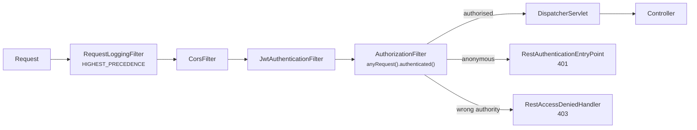

# 07 — Security and Authentication

> A source-level review is not a penetration test. This document describes what
> the code does and what it deliberately does not do. Deployment-specific
> hardening is listed at the end.

---

## The filter chain



`RequestLoggingFilter` runs first so that an authentication failure — precisely
the event someone needs to trace — is logged with a trace id.

---

## Passwords

```java
@Bean
public PasswordEncoder passwordEncoder() {
    return new BCryptPasswordEncoder(10);
}
```

BCrypt, cost 10 (≈100 ms per hash on typical hardware). Deliberately slow and
salted per password, which is what makes a stolen `users` table expensive to
crack. A general-purpose digest like SHA-256 — fast by design — would be the
wrong tool even with a salt.

Returning the `PasswordEncoder` interface rather than the concrete type means a
future move to Argon2 or a `DelegatingPasswordEncoder` touches only this method.

**Guarantees in the code:**

- The plain password exists only as a local variable inside
  `AuthService.register` and is never assigned to an entity.
- `User` has no setter taking a raw password; the only way in is
  `setPasswordHash`, called with an already-encoded value.
- `RegisterRequest.toString()` and `LoginRequest.toString()` print
  `password=***`, so an accidental `log.info("{}", request)` cannot leak it.
- `GlobalExceptionHandler.redact` replaces the rejected value of any field whose
  name contains `password`, `secret` or `token` with `***`, because validation
  error bodies end up in logs, bug reports and screenshots.
- `UserResponse` has no `passwordHash` field.

**Policy:** 10–100 characters, at least one lowercase, one uppercase and one
digit. The minimum is 10 rather than the conventional 8 because length dominates
resistance to offline cracking.

Login enforces no complexity rule — only presence and an upper length bound. It
must not reveal the registration policy, and a user whose password predates a
policy change must still be able to sign in. The upper bound exists so an
enormous string is rejected before BCrypt is asked to hash it.

---

## JWT

### Claims

```json
{
  "sub": "7",                "iss": "finsight",
  "iat": 1760428800,         "exp": 1760430600,
  "jti": "9d6b6a1e-5a4c-…",  "typ": "ACCESS",
  "eml": "asha@example.com", "rol": "ROLE_USER"
}
```

A JWT is **signed, not encrypted**. Anyone holding it can read the payload, so
nothing is in there that the holder should not already know — and certainly no
password hash. `JwtServiceTest.noSecretsInPayload` base64-decodes a real token
and asserts exactly that.

### Verification

```java
Jwts.parser()
    .verifyWith(signingKey)                              // pins HMAC
    .requireIssuer(properties.issuer())
    .clockSkewSeconds(properties.clockSkew().toSeconds())
    .build()
    .parseSignedClaims(token);
```

| Attack | Why it fails |
|---|---|
| `alg: none` | `verifyWith(SecretKey)` accepts only a MAC algorithm; an unsigned token has no valid signature |
| Algorithm confusion (RS256 token, public key as HMAC secret) | Same — the header's `alg` never selects the verification strategy |
| Tampered payload | HMAC over header+payload no longer matches |
| Foreign signature | Different key, different MAC |
| Token from another service sharing the key | `requireIssuer` rejects it |
| Expired token | `ExpiredJwtException` → `TOKEN_EXPIRED` |
| Refresh token used as a bearer credential | `typ` claim check → `TOKEN_INVALID` |

Each of these has a test in `JwtServiceTest`.

### Token confusion

The `typ` claim is the defence. Without it, a 7-day refresh token presented in an
`Authorization` header would be accepted on every endpoint — converting a refresh
credential into a long-lived API key. `JwtAuthenticationFilter` always asks for
`TokenType.ACCESS`; `/auth/refresh` always asks for `REFRESH` and takes it from
the **body**, so the filter is not even involved.

### Error disclosure

Verification failures are logged at DEBUG with the real reason and returned as a
single generic message. A verbose error ("bad signature" vs "malformed" vs
"unknown issuer") is free oracle access for someone probing the endpoint.

### Key management

| | |
|---|---|
| Source | `FINSIGHT_JWT_SECRET`, from `.env` or a real environment variable |
| Minimum | 32 bytes (256 bits), enforced at construction — startup fails otherwise |
| Generation | `head -c 64 /dev/urandom | base64 | tr -d '\n'` |
| In git | Never. `.env` is gitignored; `.env.example` holds a placeholder |
| Rotation | Not implemented. Rotating invalidates every live token. A real deployment would carry a `kid` header and verify against a small key set during the overlap. |

### Why HS256 and not RS256

For a single service there is no third party that needs to verify tokens without
also being able to mint them, so a shared secret is simpler with no loss. A
multi-service estate would want RS256/ES256 so verifiers hold only a public key.
A deliberate trade-off, not an oversight.

---

## Stateless sessions

```java
.sessionManagement(session -> session.sessionCreationPolicy(SessionCreationPolicy.STATELESS))
```

No `JSESSIONID`. The `SecurityContext` is rebuilt from the token on every
request, which is what lets several instances serve the same client without
sticky sessions or a shared session store.

**The trade-off, stated plainly.** The filter trusts verified claims and does not
re-read the user. Therefore:

- Disabling an account takes up to one access-token TTL (30 minutes) to take
  effect on API calls.
- A role change likewise.
- Logout is client-side token disposal. The server cannot invalidate an
  already-issued access token.

Mitigations if that window mattered: shorten the TTL (more refresh traffic), add
a Redis-backed denylist keyed by `jti` (reintroduces a lookup per request), or
re-read the user on sensitive operations only. `/auth/refresh` already re-reads
and rejects a disabled account, so the window closes at the next refresh.

---

## CSRF

Disabled — and that is correct here.

CSRF protection defends against the browser **automatically attaching an ambient
credential** to a cross-site request. The classic case is a session cookie: the
browser sends it to `bank.com` regardless of which page triggered the request.

This API has no ambient credential. It authenticates solely from an
`Authorization` header, which a cross-origin page cannot cause the browser to
attach. There is nothing for CSRF to exploit.

**If this application ever stored the token in a cookie, CSRF protection would
become mandatory again.** The reasoning is about the credential mechanism, not
about being "an API".

---

## CORS

```java
config.setAllowedOriginPatterns(List.of("http://localhost:*", "http://127.0.0.1:*"));
config.setAllowCredentials(false);
```

Localhost only, and `allowCredentials=false` because this API authenticates from
a header rather than a cookie. **A real deployment must replace the origin list
with the actual front-end origins** — flagged below as deployment-specific.

`allowedOriginPatterns` with a wildcard and `allowCredentials=true` together
would be the dangerous combination; it is not used.

---

## Authorization

### Roles

| Role | Grants |
|---|---|
| `ROLE_USER` | Full control over its own data, nothing else |
| `ROLE_ADMIN` | Additionally the detailed Actuator endpoints |

**No endpoint lets an admin read another user's transactions.** That would be a
privacy regression, and the ownership checks in the service layer are not
role-conditional. RBAC here governs *operational* access, not data access.

The `ROLE_` prefix is kept in the enum name because `hasRole("ADMIN")` prepends
it before comparing. Storing the prefixed form keeps the database value, the
`GrantedAuthority` and the SpEL expression consistent with no translation step
that could drift.

### Deny by default

```java
.requestMatchers(PUBLIC_ENDPOINTS).permitAll()
.requestMatchers("/actuator/health", "/actuator/health/**", "/actuator/info").permitAll()
.requestMatchers("/actuator/**").hasRole("ADMIN")
.anyRequest().authenticated()
```

Order matters: the specific health matcher precedes the broad `/actuator/**`
rule, so liveness probes stay public while metrics do not.

`JwtAuthenticationFilter.shouldNotFilter` also skips some paths, but that is an
**optimisation, not an authorization decision** — those paths are independently
`permitAll()`. Relying on a filter's skip list for access control is a
well-documented way to accidentally expose an endpoint.

---

## User-data isolation

The property this application cares about most.

### The rule

Every ownership-scoped query puts `userId` in the `WHERE` clause.

```java
// Used everywhere
Optional<Transaction> findByIdAndUserId(Long id, Long userId);

// Never written
Optional<Transaction> findById(Long id);   // …then check ownership afterwards
```

The second pattern is one forgotten `if` away from an IDOR vulnerability, and it
leaks existence through the difference between 403 and 404.

### 404, not 403

A request for another user's resource returns **404**. Returning 403 would
confirm the id exists, letting an attacker walk the id space and learn how many
transactions the system holds. Because the lookup is `findByIdAndUserId`, the two
cases are genuinely indistinguishable in the code too — this is not a cosmetic
choice applied after the fact.

The same reasoning drives the identical 401 for "wrong password" and "unknown
email": no account enumeration.

### Where the owner comes from

```java
public ResponseEntity<TransactionResponse> create(
        @AuthenticationPrincipal UserPrincipal principal, …) {
    transactionService.create(principal.getId(), request);
}
```

From the **verified token**. No endpoint accepts a `userId` parameter — not in
the body, not in the query string, not even "just for filtering".

### Filters cannot escape it

`TransactionSpecifications.forUser` applies ownership unconditionally and first,
then ANDs the optional filters. No combination of user-supplied parameters can
widen the result set. `UserDataIsolationIT.filtersCannotEscapeTheOwnerPredicate`
proves it.

### Cache isolation

Every cache key begins `finsight::<cache>::<userId>:`. There is no key a second
user could compute that collides with the first's entry.
`RedisCacheIT.identicalQueryDifferentUser` issues the same date range as two
users and asserts each gets their own figure.

### Coverage

`UserDataIsolationIT` creates two accounts, populates one, and attacks every
endpoint with the other's **valid** token. Bob is fully authenticated throughout
— this is an authorization test, and those are the ones that get missed.

| Attempt | Result |
|---|---|
| Read / update / delete another user's transaction | 404 |
| Read / update another user's category | 404 |
| Read / delete another user's budget | 404 |
| Read another user's import, or its row errors | 404 |
| Attach another user's category to your own transaction | 404 |
| See another user's rows in any list | absent; `totalElements = 0` |
| See another user's money in any report | `0.00` |
| Reach another user's data through a filter or search | no |

---

## Input validation

Defence in depth: Bean Validation at the edge, business rules in the service,
`CHECK` constraints in the database.

| Layer | Example | On failure |
|---|---|---|
| DTO | `@DecimalMin(value="0.0", inclusive=false)` on `amount` | 400 with `fieldErrors` |
| Service | category type must match transaction type | 422 |
| Database | `CHECK (amount > 0)` | constraint violation → 409 |

The database layer matters because it holds for a direct `psql` session, a buggy
migration, or a future service that forgets the check.

### SQL injection

Structurally impossible rather than filtered against:

- Repository queries are JPQL with named parameters.
- Dynamic filters are built with the **Criteria API**, so every value becomes a
  bound JDBC parameter.
- The three native queries (`claimUnpublished`, `claim`, `wasProcessed`) use
  bound parameters and contain no concatenation.
- No `String.format` or `+` ever appears in a query.

`UserDataIsolationIT.searchTermIsNotInterpretedAsSql` sends
`' OR 1=1 --` and `'; DROP TABLE transactions; --` as search terms, expects a
200 with zero results, and then confirms the table still exists.

### File upload

| Control | Value |
|---|---|
| Size | 5 MiB — enforced by the servlet container **and** again in `ImportService` |
| Rows | 50 000 |
| Extension | must be `.csv` |
| Content type | allowlist |
| Filename | sanitised: path components stripped, control characters removed, truncated to 255 |

The double size check is deliberate: the container limit is configuration someone
may raise, and a second check in the code that allocates the buffer is cheap.

---

## Sensitive logging

**Never logged:** passwords, password hashes, JWTs, the signing secret, the
database password, request bodies, query strings, the `Authorization` header,
transaction notes.

**Logged:** method, path, status, duration, trace id, user id, error codes,
masked emails (`a***a@example.com`).

`RequestLoggingFilter` sanitises an inbound `X-Trace-Id` against
`^[A-Za-z0-9_-]{1,64}$` before it reaches the MDC. The value is attacker-
controlled and ends up in log lines; a newline in it could forge an entry.

`AuthApiIT.doesNotEchoPassword` submits a weak password and asserts the 400 body
does not contain it.

---

## Error disclosure

```yaml
server:
  error:
    include-message: never
    include-binding-errors: never
    include-stacktrace: never
    include-exception: false
```

No stack trace, no exception class, no internal path ever reaches a client. The
`Exception` fallback in `GlobalExceptionHandler` returns a fixed generic message —
an exception's own message can contain a JDBC URL, a file path or part of a query
— while the full trace goes to the log under the returned `traceId`.

`AuthApiIT.errorBodiesAreSafe` asserts no response body contains `Exception`,
`at com.finsight` or `org.springframework`.

---

## Database privileges

`finsight_app` is `NOSUPERUSER NOCREATEDB NOCREATEROLE NOREPLICATION`. It owns
the `public` schema of its own two databases (Flyway needs DDL rights) and
nothing else. `PUBLIC` is revoked from both databases and cannot create objects.
`FlywayMigrationIT` and the provisioning script both assert `rolsuper = false`.

---

## Kafka message validation

A consumer must never assume a message is well-formed just because it
deserialised — it may come from an older producer, a hand-crafted test, or a
replayed dead-letter record.

```java
public boolean isValid() {
    return eventId != null
        && importJobId != null && importJobId > 0
        && userId != null && userId > 0
        && fileChecksum != null && fileChecksum.matches("^[0-9a-f]{64}$")
        && TYPE.equals(eventType);
}
```

Invalid messages throw `IllegalArgumentException`, classified non-retryable, and
go straight to the DLT.

`ImportProcessor.processJob` then re-checks the event's `userId` against the
stored job. Importing one user's rows into another's account would be the worst
possible outcome, so the event's assertion about ownership is verified rather
than trusted.

---

## Resource limits

| Limit | Value | Prevents |
|---|---|---|
| Page size | 200 (100 for report breakdowns) | `?size=1000000` as a one-request DoS |
| Report range | 3660 days | `?from=0001-01-01&to=9999-12-31` full scans |
| Monthly series | 120 months | unbounded bucket construction |
| Upload | 5 MiB / 50 000 rows | memory exhaustion |
| Connection pool | 10, 10 s timeout | fail fast rather than hanging request threads |
| Redis timeout | 2 s | a slow cache must not slow the request |
| Outbox batch | 100 | bounded work per pass |
| Kafka `max-poll-records` | 1 | one import at a time per consumer thread |

**Not implemented: per-user rate limiting.** Login is not throttled, so online
password guessing is only bounded by BCrypt's cost. That is a real gap, listed
below.

---

## Security headers

```java
.frameOptions(frame -> frame.deny())                 // X-Frame-Options: DENY
.contentTypeOptions(opts -> {})                      // X-Content-Type-Options: nosniff
.referrerPolicy(… SAME_ORIGIN)
.httpStrictTransportSecurity(hsts -> hsts.includeSubDomains(true).maxAgeInSeconds(31_536_000))
```

HSTS only has effect over HTTPS; it is set so a TLS-terminated deployment gets it
without a code change.

---

## Dependency management

Versions come from the Spring Boot BOM, so the whole set is tested together.
Four are pinned directly: `jjwt` 0.12.6, `springdoc` 2.8.13, `opencsv` 5.9,
`jacoco` 0.8.13.

The CI `security` job runs `dependency:tree` and a `git grep` for
credential-shaped strings in tracked files. It is **advisory** —
`continue-on-error: true` — because a newly disclosed CVE in a transitive
dependency should surface in the logs, not block an unrelated pull request.

No automated CVE scanner (OWASP Dependency-Check, Snyk, Trivy) is wired in. That
is a gap, not a claim of safety.

---

## Known gaps and deployment-specific hardening

Stated plainly. A portfolio project that overclaims is worse than one that does
less honestly.

### Implemented and verified

Password hashing · JWT signature, issuer, expiry and type verification ·
user-data isolation across every endpoint · SQL-injection resistance · upload
limits and filename sanitisation · error-disclosure control · least-privilege
database role · cache key isolation · security headers · deny-by-default
authorization.

### Implemented but not verified

Dead-letter routing — the code and configuration exist, but no test forces a
consumer failure, so no claim is made that the path has been observed working.
Message validation on the consumer *is* exercised against a real broker; see
[08-KAFKA-AND-ASYNCHRONOUS-PROCESSING](08-KAFKA-AND-ASYNCHRONOUS-PROCESSING.md).

### Known gaps

| Gap | Consequence | Would need |
|---|---|---|
| No refresh-token revocation or rotation | A leaked refresh token stays valid for 7 days | Store token ids; rotate on use and detect reuse |
| No access-token denylist | Disabling an account takes up to 30 minutes to apply to API calls | Redis denylist keyed by `jti` |
| No rate limiting | Online password guessing bounded only by BCrypt cost | Bucket4j, or a gateway/WAF |
| No account lockout | Same | Failed-attempt counter with backoff |
| No MFA | Single factor | TOTP |
| No audit log | Cannot reconstruct who changed what | Append-only audit table |
| No automated CVE scanning | Vulnerable transitives go unnoticed | Dependency-Check / Snyk / Trivy in CI |
| No field-level encryption | Notes and merchants are plaintext at rest | Column encryption, or disk encryption |

### Required before any real deployment

1. **TLS.** The application serves plain HTTP. Terminate TLS at a reverse proxy
   or load balancer; set `server.forward-headers-strategy=framework` so Spring
   honours `X-Forwarded-*`.
2. **Replace the CORS origin list** with the real front-end origins.
3. **Secrets from a secret manager**, not a `.env` file — Vault, AWS Secrets
   Manager, Kubernetes secrets.
4. **Rotate every generated value.** The provisioning script's output is for
   local development.
5. **Restrict Actuator** to an internal network, not just to `ROLE_ADMIN`.
6. **Add rate limiting** in front of `/auth/*`.
7. **Backups**, and a tested restore.
8. **Centralised logs** with retention and alerting on
   `finsight.outbox.parked > 0`.
9. **A penetration test.** Reading source code is not one.
