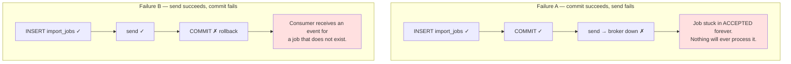
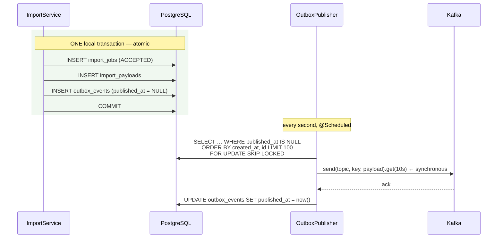
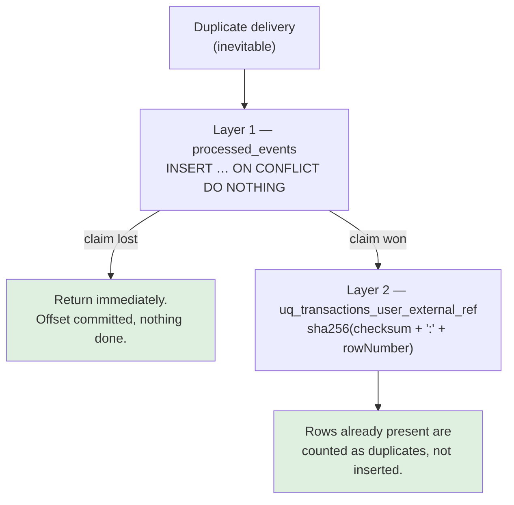
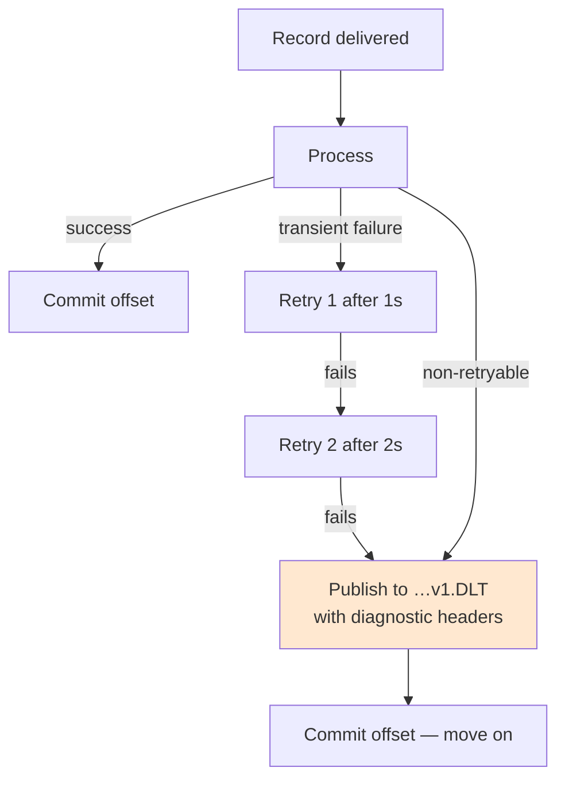

# 08 — Kafka and Asynchronous Processing

> **Verification status: verified end to end.** `OutboxIT` covers the database
> half against real PostgreSQL; `KafkaImportIT` covers publish → deliver →
> consume through a real broker, including a deliberately forced redelivery.
> Both pass. The pipeline was also exercised manually against the running
> application: a 506-row upload returned 202, the outbox row was published on the
> first attempt, the consumer applied all 506 rows, and consumer-group lag
> returned to 0.
>
> **Still unverified:** retry backoff and dead-letter routing. Those paths are
> implemented and configured but no test forces a consumer failure, so nothing
> here claims they have been observed working.

---

## Why asynchronous at all

A 5 000-row CSV takes seconds to insert. Doing that inside the HTTP request:

- ties up a request thread for the duration,
- risks a client, proxy or load-balancer timeout mid-insert,
- gives the user no way to find out what happened if the connection drops.

So uploads above `finsight.csv-import.async-threshold-rows` (default 50) are
accepted, stored, and processed out of band. Smaller files are processed inline —
a two-row import should not require polling.

---

## The dual-write problem

The naive implementation:

```java
@Transactional
public void upload(...) {
    jobRepository.save(job);                    // PostgreSQL
    kafkaTemplate.send(topic, event);           // Kafka  ← different system
}
```

These two systems share no transaction. Two failure modes:



Moving the send after the commit does not help — it only changes which failure
you get. Neither does a `TransactionSynchronization` afterCommit hook: the
process can die between the commit and the hook.

---

## The transactional outbox

Stop doing a dual write. Write the event **as a row**, in the same local
transaction as the business change. A separate poller publishes it.



Either the job and its event are both durable, or neither is. There is no state
where a job waits forever for an event that was never recorded.

### `Propagation.MANDATORY`

```java
@Transactional(propagation = Propagation.MANDATORY)
public OutboxEvent recordImportRequested(...) { … }
```

The single most important line in the package. It **refuses to run** unless a
transaction is already in progress. Recording the event in its own transaction
would silently reintroduce the dual write the outbox exists to eliminate, and the
bug would be invisible until an incident. A loud `IllegalTransactionStateException`
is far better.

### `FOR UPDATE SKIP LOCKED`

```sql
SELECT * FROM outbox_events
WHERE published_at IS NULL AND attempts < :maxAttempts
ORDER BY created_at, id
LIMIT :batchSize
FOR UPDATE SKIP LOCKED
```

This is what makes the poller safe on several application instances at once.
Each locks the rows it reads; others step **over** the locked rows rather than
blocking on them.

| Variant | Result |
|---|---|
| No locking | Every instance publishes every event |
| `FOR UPDATE` alone | Instances serialise behind one another |
| `FOR UPDATE SKIP LOCKED` | Instances work on disjoint batches, concurrently |

A native query because JPQL cannot express `SKIP LOCKED`, and
`@Lock(PESSIMISTIC_WRITE)` would block rather than skip.

### Why the send is synchronous

```java
kafkaTemplate.send(topic, key, payload).get(10, TimeUnit.SECONDS);
event.markPublished();
```

An asynchronous send would let `published_at` commit before the broker accepted
the record — and a later rejection would leave a row marked published that never
was. Waiting for the ack keeps the database's view and the broker's view in
agreement. The cost is throughput, bounded here by `batchSize` and irrelevant at
this scale.

### Partial index

```sql
CREATE INDEX idx_outbox_unpublished
    ON outbox_events (created_at, id) WHERE published_at IS NULL;
```

The poller's only predicate. The index stays tiny even after millions of rows are
published, because published rows are not in it.

---

## Delivery guarantees, stated precisely

**This pipeline provides at-least-once delivery. Not exactly-once.**

Using Kafka does not change that, and nothing in this project claims otherwise.

### Where a duplicate comes from

```
1. Poller sends the record          → broker acknowledges ✓
2. Poller is about to commit published_at
3. *** process dies ***
4. On restart: published_at is still NULL
5. Next pass publishes the same event again
```

The window is small. It is not zero, and it cannot be made zero without a
distributed transaction between PostgreSQL and Kafka — which neither supports in
a usable form.

Kafka's own `enable.idempotence=true` (set here) deduplicates the *producer's*
internal retries within a session. It does nothing about a republish from a
different process after a restart.

### Why that is fine

Because duplicate **delivery** is prevented from becoming duplicate **effects**,
by two independent mechanisms.



Two layers, because this is financial data and one of them could be bypassed by a
future change.

#### Layer 1 — the idempotency ledger

```sql
INSERT INTO processed_events (event_id, consumer_group, processed_at)
VALUES (?, ?, now())
ON CONFLICT (event_id, consumer_group) DO NOTHING
```

Returns 1 for the winner, 0 for a redelivery.

| Alternative | Why it is wrong |
|---|---|
| `existsById()` then `save()` | Two threads can both read "not processed" and both do the work. The check and the write must be one statement. |
| Catch the constraint violation | An exception marks the PostgreSQL transaction rollback-only, forcing a savepoint dance for a completely normal outcome. |

The key is `(event_id, consumer_group)`, not `event_id` alone: different consumer
groups are independent subscribers and each must get its own chance.

**The claim shares the work's transaction.** If processing fails, the claim rolls
back with it and a retry is free to try again. Claiming separately would mean a
crash after the claim but before the work leaves the event permanently marked
done and never performed.

#### Layer 2 — the row-level key

```java
externalRef = sha256(fileChecksum + ":" + rowNumber)
```

Under `uq_transactions_user_external_ref`. Depends only on file **content** and
row **position**, so it is stable across retries, restarts and re-uploads.

Even with the ledger bypassed entirely, the rows cannot be inserted twice.

**The stated limit:** this is content-*and-position* based. The same rows in a
different order produce different keys and would import again. The alternative —
hashing content alone — would reject the legitimate case of two identical coffees
in one file. The trade-off is deliberate, not an oversight.

---

## Topics and schema

| | |
|---|---|
| Topic | `finsight.imports.requested.v1` |
| Dead letter | `finsight.imports.requested.v1.DLT` |
| Key | import job id — all events for one job share a partition and keep their order |
| Value | JSON |

```json
{
  "eventId":      "9d6b6a1e-5a4c-4f0e-9a7c-2f1b3d4e5f60",
  "eventType":    "ImportRequested",
  "importJobId":  42,
  "userId":       7,
  "fileChecksum": "3b1f…e9",
  "totalRows":    1200,
  "occurredAt":   "2026-10-14T06:12:44.182Z"
}
```

**The version is in the topic name**, not a payload field. A breaking change gets
a new topic, so old and new consumers run side by side during a rollout rather
than one of them failing to deserialise. Backwards-compatible changes — adding an
optional field — stay on v1, which is safe because the consumer ignores unknown
properties.

**The CSV content is deliberately absent.** It lives in `import_payloads` and the
consumer reads it by id. Kafka's default 1 MiB message limit makes shipping files
through the broker fragile, and the payload would then exist in two places with
no way to keep them consistent. `OutboxIT.payloadExcludesFileContent` asserts it.

---

## Producer configuration

```yaml
acks: all
retries: 5
properties:
  enable.idempotence: true
  max.in.flight.requests.per.connection: 5
  delivery.timeout.ms: 30000
```

| Setting | Why |
|---|---|
| `acks: all` | No acknowledged write without full ISR replication. `acks=1` would lose data on a leader failure. |
| `enable.idempotence: true` | The broker deduplicates the producer's internal retries. Without it, `retries > 0` can itself create duplicates. |
| `max.in.flight ≤ 5` | Required for idempotence to preserve ordering |

---

## Consumer configuration

```yaml
enable-auto-commit: false
auto-offset-reset: earliest
max-poll-records: 1
properties:
  max.poll.interval.ms: 600000
listener:
  ack-mode: record
  concurrency: 2
  missing-topics-fatal: false
```

| Setting | Why |
|---|---|
| `enable-auto-commit: false` | The offset commits only after the listener returns normally. Auto-commit can advance the offset for a record that then fails — **silent data loss**. |
| `auto-offset-reset: earliest` | A new consumer group processes the backlog rather than skipping it |
| `max-poll-records: 1` | One import at a time per thread; a large import must not starve its siblings |
| `max.poll.interval.ms: 600000` | A large CSV may legitimately take minutes; a shorter interval would trigger a rebalance mid-import |
| `missing-topics-fatal: false` | The application still boots when the broker has no topics yet |

---

## Retries and the dead-letter topic



```java
ExponentialBackOff backOff = new ExponentialBackOff(1000, 2.0);
backOff.setMaxAttempts(retry.attempts() - 1);
backOff.setMaxInterval(30_000L);

DefaultErrorHandler handler = new DefaultErrorHandler(recoverer, backOff);
handler.addNotRetryableExceptions(
        ConversionException.class, JsonProcessingException.class, IllegalArgumentException.class);
```

### Why a DLT is mandatory

Without one, a message the consumer can never handle — a **poison pill** — blocks
its partition forever: the container retries, fails, declines to commit,
re-polls the same offset, and **no later message is ever processed**. One bad
message stops the whole queue.

The `DeadLetterPublishingRecoverer` copies the record — headers, key and value
intact, plus headers naming the original topic, partition, offset and exception —
onto `…v1.DLT`, and the offset is then committed so the consumer moves on.

### Retryable vs not

| Classification | Examples | Reasoning |
|---|---|---|
| **Retryable** | Database connection blip, lock timeout, Redis hiccup | Transient; a later attempt may succeed |
| **Non-retryable** | Deserialisation failure, schema validation failure, ownership mismatch | The payload itself is wrong. Bytes do not become valid on the third attempt — retrying burns the backoff budget and delays every message behind it. |

### Retry does not make processing safe

This is worth separating clearly, because the two are often conflated:

- **Retry** handles transient failure. It makes an operation *attempted* again.
- **Idempotency** handles repeated execution. It makes an operation *safe* to
  attempt again.

Retry **without** idempotency is how duplicate financial records get created.
Both are implemented here.

---

## Failure scenarios and recovery

### Kafka is down

- **Synchronous imports are unaffected.** Files below the threshold never touch
  Kafka.
- Large uploads still return 202 — the row is durably stored.
- The publisher fails, increments `attempts`, records the reason, and retries on
  the next pass.
- `finsight.outbox.pending` rises.
- After `maxAttempts` (10) a row is **parked** and `finsight.outbox.parked` rises.

**Recovery:** start the broker. Parked rows need a nudge:

```sql
-- Inspect first
SELECT id, event_id, event_type, attempts, last_error, created_at
FROM outbox_events WHERE published_at IS NULL AND attempts >= 10;

-- Re-arm once the cause is fixed
UPDATE outbox_events SET attempts = 0, last_error = NULL
WHERE published_at IS NULL AND attempts >= 10;
```

Safe because publishing again is exactly the at-least-once case the consumer
already absorbs.

### The consumer crashes mid-import

The transaction — including the `processed_events` claim — rolls back. Kafka
redelivers. The claim is free again and processing restarts. Any rows already
inserted by an earlier partial attempt are caught by `external_ref` and counted
as duplicates.

### A duplicate message arrives

`claim` returns 0. The consumer logs, increments
`finsight.kafka.events{outcome="skipped_duplicate"}` and returns — committing the
offset without doing the work. That counter is direct evidence of at-least-once
delivery happening in production.

### The job was deleted after the event was published

`processJob` logs and returns normally. Throwing would send the message round the
retry loop and into the DLT for nothing: there is no work to do and no retry that
would help.

### Retry storms

Bounded by design: exponential backoff capped at 30 s, three delivery attempts,
then the DLT; `max-poll-records: 1` and `concurrency: 2` cap in-flight work;
outbox `batchSize: 100` caps work per pass; parking stops infinite republishing.

### Inspecting the DLT

```bash
sudo docker exec finsight-kafka kafka-console-consumer \
  --bootstrap-server localhost:9092 \
  --topic finsight.imports.requested.v1.DLT \
  --from-beginning --property print.headers=true
```

The headers name the original topic, partition, offset and the exception that
caused the routing.

**Replaying** is a manual, deliberate act — automatic replay of a message that
already failed three times is a loop. Fix the cause, then produce the record back
onto the main topic. The idempotency ledger makes replay safe.

---

## Observability

| Meter | Type | Meaning |
|---|---|---|
| `finsight.outbox.pending` | gauge | Unpublished events. Rising = publication is behind. |
| `finsight.outbox.parked` | gauge | Gave up. **Non-zero needs a human.** |
| `finsight.outbox.published` | counter | Broker-acknowledged |
| `finsight.outbox.publish.failures` | counter | Failed attempts |
| `finsight.kafka.events{outcome=processed}` | counter | Events applied |
| `finsight.kafka.events{outcome=skipped_duplicate}` | counter | Redeliveries absorbed |
| `finsight.import.rows{outcome}` | counter | `imported` / `duplicate` / `failed` |

Suggested alerts: `parked > 0` for 5 minutes; `pending > 1000` for 10 minutes.

---

## Running and verifying it locally

```bash
sudo docker compose up -d kafka
sudo docker compose logs -f kafka          # wait for "Kafka Server started"

sudo docker exec finsight-kafka kafka-topics \
  --bootstrap-server localhost:9092 --list
```

```bash
./scripts/generate-large-csv.sh 500 samples/large-import.csv

JOB=$(curl -s -X POST http://localhost:8080/api/v1/imports \
  -H "Authorization: Bearer $TOKEN" \
  -F "file=@samples/large-import.csv" | jq -r .id)

# Expect 202 and status ACCEPTED, then watch it progress
until curl -s "http://localhost:8080/api/v1/imports/$JOB" \
      -H "Authorization: Bearer $TOKEN" | jq -e '.terminal' >/dev/null; do
  curl -s "http://localhost:8080/api/v1/imports/$JOB" \
    -H "Authorization: Bearer $TOKEN" | jq -c '{status, importedRows, failedRows}'
  sleep 1
done
```

Watch the event flow:

```bash
sudo docker exec finsight-kafka kafka-console-consumer \
  --bootstrap-server localhost:9092 \
  --topic finsight.imports.requested.v1 --from-beginning
```

Confirm the outbox drained:

```sql
SELECT count(*) FILTER (WHERE published_at IS NULL) AS pending,
       count(*) FILTER (WHERE published_at IS NOT NULL) AS published
FROM outbox_events;
```

### Tests

| Test | Needs | Covers |
|---|---|---|
| `OutboxIT` | PostgreSQL | Atomic write, claim query, `SKIP LOCKED` filtering, parking, the ledger's single-winner property, failure recording |
| `ImportProcessorTest` | nothing | Key determinism, duplicate counting, counters not accumulating, errors cleared on retry, ownership mismatch rejected |
| `CsvImportIT` | PostgreSQL | End-to-end idempotency against the real unique index |

**Not covered by an executed test:** the broker round trip itself — publish,
deliver, retry, DLT routing. That requires a running Kafka and is listed as
unverified.

---

## What a production deployment would add

| | |
|---|---|
| Replication | `replicas: 3`, `min.insync.replicas: 2`. The compose file uses 1 because it runs one broker. |
| Partitions | More than 1, to allow consumer parallelism |
| Schema registry | Avro or Protobuf with enforced compatibility, instead of hand-validated JSON |
| Outbox retention | A scheduled purge of published rows older than N days |
| DLT alerting | Alert on any message landing there |
| Tracing | Propagate the trace id through Kafka headers so a request can be followed across the async boundary |
