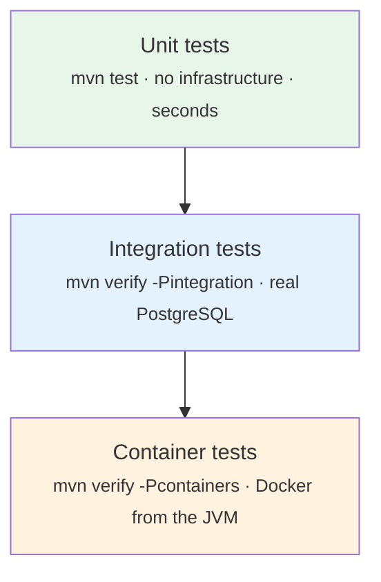

# 10 — Testing and Debugging

## Strategy

Three tiers, separated by what infrastructure they need. The separation is the
point: a developer must be able to run *something* meaningful in seconds, and CI
must be able to run *everything*.



| Tier | Command | Needs | Covers |
|---|---|---|---|
| Unit | `mvn test` | nothing | Money arithmetic, hashing, date rules, JWT, CSV parsing, service decisions |
| Integration | `mvn verify -Pintegration` | PostgreSQL + `finsight_test_db` | Migrations, real constraints, full HTTP stack, security, data isolation |
| Container | `mvn verify -Pcontainers` | Docker reachable from the JVM | Testcontainers-backed variants |

```bash
mvn test                         # always runnable
mvn verify -Pintegration         # after scripts/provision-db.sh
mvn verify -Pintegration -Dtest=CsvImportIT
mvn verify -Pintegration -Dit.test=UserDataIsolationIT#cannotReadForeignTransaction
```

### How the separation is enforced

```xml
<!-- surefire: unit tests only -->
<excludedGroups>integration,testcontainers,kafka,redis</excludedGroups>
<includes><include>**/*Test.java</include></includes>

<!-- failsafe: integration tests, skipped unless -Pintegration -->
<skipITs>${skipITs}</skipITs>
<includes><include>**/*IT.java</include></includes>
```

Naming carries the meaning: `*Test` is a unit test, `*IT` is an integration test.
`@Tag` narrows further (`redis`, `kafka`, `testcontainers`).

**The test suite does not depend on a running Kafka or Redis.** That is
deliberate — a suite that cannot run without a broker is a suite that stops being
run.

---

## Unit tests

Fast, deterministic, no Spring context. 179 of them.

| Class | Tests | What it pins down |
|---|---|---|
| `MoneyTest` | 18 | HALF_UP rounding, scale, null handling, division-by-zero returning 0, exactness across 365 additions |
| `HashesTest` | 8 | Known SHA-256 vector, stability, normalisation, **field-boundary collisions** |
| `DateRangesTest` | 9 | Inclusive bounds, inverted ranges, span cap, leap years |
| `JwtServiceTest` | 15 | Round-trip, expiry, clock skew, `alg:none`, tampering, foreign signature, wrong issuer, token-type confusion, weak-key rejection |
| `CsvTransactionParserTest` | 47 | Formats, aliases, strict dates, amount cleaning, partial failure, structural rejection |
| `BudgetResponseTest` | 18 | Status thresholds at every boundary, negative remaining, null spend |
| `TransactionServiceTest` | 19 | Ownership in the query, validation, cache eviction, page-size cap |
| `ReportServiceTest` | 21 | Empty periods, densification, averages, page-independent percentages |
| `ImportProcessorTest` | 24 | Key determinism, duplicate counting, counters not accumulating, lifecycle |

### What a good test looks like here

```java
@Test
@DisplayName("are exact where binary floating point is not")
void exactDecimalArithmetic() {
    // 0.1 + 0.2 == 0.30000000000000004 as a double. This is the single
    // clearest reason the whole application uses BigDecimal for money.
    assertThat(Money.add(new BigDecimal("0.10"), new BigDecimal("0.20")))
            .isEqualByComparingTo("0.30");

    assertThat(0.1 + 0.2).isNotEqualTo(0.3);   // the behaviour being avoided
}
```

The second assertion is not padding. It documents *why* the first one matters,
inside the test, where someone changing the code will read it.

### A clock, not a sleep

```java
JwtService later = new JwtService(properties,
        Clock.fixed(NOW.plus(Duration.ofMinutes(31)), ZoneOffset.UTC));

assertThatThrownBy(() -> later.verify(token, TokenType.ACCESS))
        .extracting(e -> ((ApiException) e).errorCode())
        .isEqualTo(ErrorCode.TOKEN_EXPIRED);
```

`JwtService` has a package-private clock-injecting constructor purely so expiry
can be tested by moving time. `Thread.sleep(31 * 60 * 1000)` would be both absurd
and flaky.

### These tests found real bugs

Three, on their first run, all in `CsvTransactionParser`:

1. **`31/02/2026` was accepted** and silently became 28 February. `DateTimeFormatter`
   defaults to `ResolverStyle.SMART`, which *adjusts* an impossible day rather
   than rejecting it. Fixed with `ResolverStyle.STRICT` and `uuuu` patterns.
2. **A blank line aborted the entire file.** `CSVReaderHeaderAware` throws when a
   line's column count differs from the header. Fixed by resolving the header
   once and indexing into each row, so a ragged line becomes one row error.
3. **A cascading failure** in the partial-failure test, caused by (1).

That is the value proposition of the unit tier in one example: silently filing a
February transaction on the wrong date is exactly the kind of bug that never
produces an exception and is discovered months later by a confused user.

### And four more that only running it could find

The unit suite was green while all four of these were live. They are the argument
for the integration tier, and for actually starting the application:

1. **A missing `updated_at` column** on `import_jobs` — caught by Hibernate's
   `ddl-auto=validate` at context startup.
2. **`JwtService` could not be constructed by Spring** — two constructors, neither
   annotated. Unit tests call `new`, so only a real context exposed it.
3. **`commons-pool2` missing** while Lettuce pooling was configured.
4. **Every Redis cache *hit* failed** — values stored without type information
   deserialised to a `LinkedHashMap`. Misses worked, so the cache looked healthy.
   Only a test that re-read a key could find it.

Full detail in [FINAL-DELIVERY-REPORT.md](../FINAL-DELIVERY-REPORT.md) §2.

---

## Integration tests

Real PostgreSQL, real Flyway, real constraints, the full servlet stack.

```java
@SpringBootTest
@AutoConfigureMockMvc
@ActiveProfiles("test")
@Tag("integration")
public abstract class AbstractIntegrationTest { … }
```

### Why MockMvc rather than a live port

`MockMvc` runs the full servlet stack in-process — filters, security, argument
resolvers, the exception handler, message converters. It is a genuine test of the
web layer while avoiding a real socket, and it keeps each test on **one thread**,
which is what makes `@Transactional` rollback work.

`@SpringBootTest(webEnvironment = RANDOM_PORT)` with `TestRestTemplate` would run
the server on a different thread, so a test-managed transaction would not be
visible to it — and rollback-based isolation would silently stop working.

### Isolation

Subclasses are `@Transactional`, so each test rolls back. Tests that must observe
committed state (`RedisCacheIT`, because cache writes happen on commit) are not,
and clean up explicitly.

Every account gets a unique email:

```java
protected String uniqueEmail(String label) {
    return "%s.%d.%d@example.test".formatted(label, System.nanoTime(), SEQUENCE.incrementAndGet());
}
```

A leaked row from one test can then never make another fail mysteriously.

### The suite

| Test | Covers |
|---|---|
| `FlywayMigrationIT` | Version list, tables, **indexes**, CHECK constraints, seed data, column types |
| `AuthApiIT` | Registration, BCrypt storage, login, no account enumeration, refresh, token-type confusion, safe error bodies |
| `UserDataIsolationIT` | Every endpoint attacked with a second user's valid token |
| `TransactionApiIT` | CRUD, validation, every filter, sorting, paging, page-size cap |
| `CsvImportIT` | End-to-end import, **idempotency against the real unique index**, partial failure, rejections |
| `ReportApiIT` | Hand-checkable totals, inclusive boundaries, empty periods, densification, page-independent percentages, budget agreement |
| `OutboxIT` | Atomic write, claim query, parking, the ledger's single-winner property |
| `RedisCacheIT` | Key isolation, TTL, **cache hits**, per-user eviction *(skips without Redis)* |
| `KafkaImportIT` | **Full broker round trip** — publish, deliver, consume — plus a forced redelivery absorbed by the idempotency ledger *(skips without Kafka)* |

### `FlywayMigrationIT` asserts what an ORM cannot

```java
assertThat(indexNames("transactions")).contains(
        "idx_transactions_user_date",
        "uq_transactions_user_external_ref", …);
```

A dropped index is invisible to Hibernate and to every functional test — right up
until a report takes thirty seconds in production. Likewise:

```java
assertThatThrownBy(() -> jdbc.update("""
        INSERT INTO transactions (user_id, type, amount, txn_date, description, dedupe_hash)
        VALUES (1, 'EXPENSE', -100, '2026-03-01', 'Negative', ?)
        """, "0".repeat(64)))
        .hasMessageContaining("ck_transactions_amount");
```

The application validates this too, but the constraint is the *real* guarantee —
it holds for a direct `psql` session or a future service that forgets the check.

And the one that would be catastrophic if wrong:

```java
assertThat(dataType).isEqualTo("numeric");
assertThat(precision).isEqualTo(19);
assertThat(scale).isEqualTo(4);
```

### `UserDataIsolationIT` is an authorization test

Bob is **fully authenticated** throughout, holding a valid token, using Alice's
resource ids. Authentication tests are rarely forgotten; authorization tests
routinely are.

```java
@Test
@DisplayName("a SQL-injection attempt in a filter is treated as a literal string")
void searchTermIsNotInterpretedAsSql() throws Exception {
    mockMvc.perform(get("/api/v1/transactions").param("search", "' OR 1=1 --")
                    .header("Authorization", bearer(bob)))
            .andExpect(status().isOk())
            .andExpect(jsonPath("$.totalElements").value(0));
    …
    // And the table is still there.
}
```

### `ReportApiIT` uses hand-checkable numbers

```
2026-03-01  INCOME   95 000.00   Salary
2026-03-10  EXPENSE   5 000.00   Groceries
2026-03-20  EXPENSE   3 000.00   Dining
2026-03-31  EXPENSE   2 000.00   (uncategorised)   ← last day, boundary case
```

Income 95 000, expense 10 000, net 85 000. Every expected value in the test can
be verified by arithmetic, not by trusting the implementation. The 31 March row
exists specifically to catch an exclusive upper bound — the classic off-by-one in
date-range reporting.

---

## Testcontainers

Declared and compiled; tagged `testcontainers` and excluded by default.

**They did not run in the author's environment.** That workstation's Docker
socket is root-owned and the JVM cannot reach it, so Testcontainers cannot start
a container. The honest options were to skip them with a clear tag or to pretend
otherwise; this project skips them and says so.

CI uses **GitHub Actions service containers** instead — real PostgreSQL and Redis
on the runner, reached over localhost. Same confidence, no socket access needed.

To run them where Docker *is* reachable:

```bash
sudo usermod -aG docker "$USER" && newgrp docker   # root-equivalent; understand this first
mvn verify -Pcontainers
```

---

## Coverage

```bash
mvn verify -Pintegration
xdg-open target/site/jacoco/index.html
```

DTOs and the main class are excluded — records with generated accessors inflate
the number without adding information.

**No coverage figure is quoted anywhere in this project**, and no threshold gate
is configured. A percentage is trivially gamed by exercising getters, and a
specific number would be stale the moment anything changed. The honest
statements are:

- The complex, decision-heavy classes — `CsvTransactionParser`, `JwtService`,
  `Money`, `ImportProcessor`, `ReportService`, `BudgetResponse` — have thorough
  unit tests, including their error paths.
- Every endpoint is exercised by an integration test.
- Every ownership-scoped endpoint has an explicit cross-user test.

### Critical paths and their status

| Path | Status |
|---|---|
| Money arithmetic | ✅ unit |
| JWT verification, every attack | ✅ unit |
| CSV parsing and validation | ✅ unit |
| Flyway migrations, indexes, constraints | ✅ integration |
| User-data isolation, every endpoint | ✅ integration |
| Import idempotency against the real index | ✅ integration |
| Report correctness and boundaries | ✅ integration |
| Outbox atomicity and the ledger | ✅ integration |
| Redis caching | ✅ integration, verified against live Redis |
| Kafka publish → deliver → consume | ✅ integration (`KafkaImportIT`) against a real broker |
| Kafka retry and DLT routing | ❌ **not executed** — implemented and configured, but no test forces a consumer failure |
| Concurrency under real load | ❌ not tested |
| Performance | ❌ not measured. **No benchmark numbers appear anywhere in this project.** |

---

## Debugging in IntelliJ IDEA

### Setup

1. **Run → Edit Configurations → Spring Boot → FinSightApplication.**
   Working directory must be the project root so `.env` is found.
2. For a test: right-click the class or method → **Debug**.

### Where to put a breakpoint

| Question | Breakpoint |
|---|---|
| Is my token being accepted? | `JwtAuthenticationFilter.doFilterInternal`, line after `extractBearerToken` |
| Why is this 401? | `JwtService.parse`, in the `catch` blocks |
| Why is this 403? | `RestAccessDeniedHandler.handle` |
| Why is this 404 when the row exists? | `TransactionService.requireOwned` — inspect both arguments |
| Why is my report wrong? | `ReportService.summary`, after the repository call |
| Why did this row fail to import? | `CsvTransactionParser.parseRow`, with a condition |
| Is the cache being hit? | `UserCacheEvictor.evictUser` and watch the Redis keys |
| Is the outbox row written? | `OutboxRecorder.recordImportRequested` |

### Conditional breakpoints

Essential when debugging an import — you do not want to stop on 5 000 rows.
Right-click the breakpoint and set a condition:

```java
rowNumber == 57
```

```java
principal.getId() == 7L
```

```java
request.amount().compareTo(new BigDecimal("1000")) > 0
```

### Seeing the SQL

Temporarily, in `application-test.yml` or via a VM option:

```yaml
logging:
  level:
    org.hibernate.SQL: DEBUG
    org.hibernate.orm.jdbc.bind: TRACE
```

`bind: TRACE` is the one that matters — it shows the **parameter values**, so you
can see that `user_id` was 8 when you expected 7.

Leave both off by default: they are extremely verbose and would log financial
values.

### Catching an N+1

Turn on `org.hibernate.SQL: DEBUG`, request a 20-row page, and count the
statements. One means the `@EntityGraph` is working. Twenty-one means someone
removed it.

### Debugging the Kafka consumer

```yaml
finsight:
  kafka:
    consumer-enabled: true
logging:
  level:
    org.springframework.kafka: DEBUG
```

Then breakpoint `ImportEventConsumer.onImportRequested`. Note the listener runs on
a container thread, not a request thread — the MDC `traceId` from the original
upload is *not* present, which is why the consumer puts `eventId` into the MDC
itself.

---

## Common test failures

### `Connection refused` / `database "finsight_test_db" does not exist`

```bash
sudo bash scripts/provision-db.sh
pg_lsclusters
```

### `Could not resolve placeholder 'FINSIGHT_DB_PASSWORD'`

`.env` is missing, or Maven was run from a different directory.

```bash
cd /path/to/FinSight && mvn verify -Pintegration
```

### `Schema-validation: wrong column type encountered`

An entity and the migrations disagree. **The message names the column.** Fix the
entity, or add a migration — never both guessing.

### A test passes alone and fails in the suite

Shared state. Check that the test is `@Transactional`, and that it uses
`uniqueEmail(...)` rather than a fixed address.

### `RedisCacheIT` reports as skipped

Expected without Redis. `sudo docker compose up -d redis` to run it.

### `MockMvc` returns 401 unexpectedly

The `Authorization` header was not set, or `registerUser` was not awaited. Add
`.andDo(print())` to dump the full request and response.

---

## Writing a new test

### Unit

```java
@ExtendWith(MockitoExtension.class)
class MyServiceTest {

    @Mock private MyRepository repository;
    @InjectMocks private MyService service;

    @Test
    @DisplayName("states the behaviour, not the method name")
    void doesTheThing() {
        when(repository.find(1L)).thenReturn(Optional.of(entity));

        var result = service.doSomething(1L);

        assertThat(result.field()).isEqualTo("expected");
    }
}
```

### Integration

```java
@Transactional
class MyApiIT extends AbstractIntegrationTest {

    @Test
    void endpointBehavesCorrectly() throws Exception {
        AuthResponse user = registerUser("mytest");

        mockMvc.perform(get("/api/v1/thing").header("Authorization", bearer(user)))
                .andExpect(status().isOk())
                .andExpect(jsonPath("$.field").value("expected"));
    }
}
```

### Conventions

- `@DisplayName` states the **behaviour**, not the method name. The report should
  read as a specification.
- `@Nested` groups related cases.
- Assert **one behaviour** per test, with as many assertions as that behaviour
  needs.
- Use AssertJ (`assertThat`) throughout — better failure messages and a fluent
  API for collections.
- For `BigDecimal` use `isEqualByComparingTo`, never `isEqualTo`: `0.10` and
  `0.1` are numerically equal but not `equals`.
- When a test encodes a non-obvious decision, say why in a comment. The test is
  where someone changing the code will read it.
