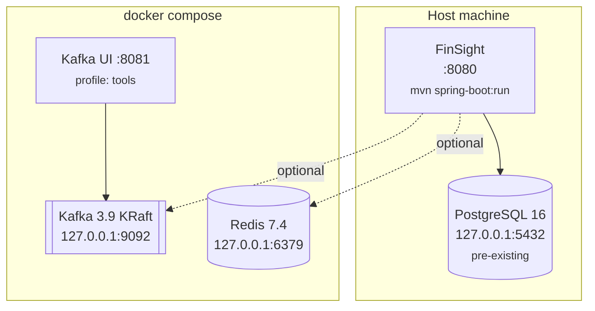
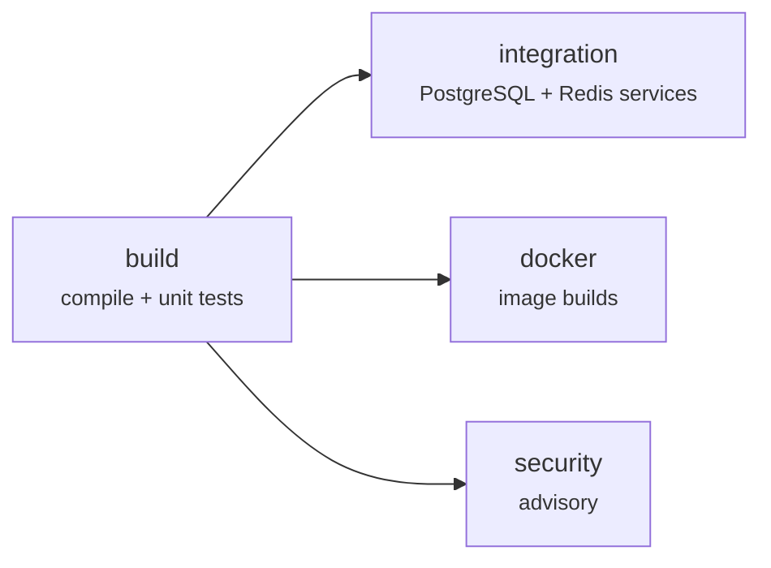

# 11 — Docker and Deployment

> **Verification status.** The Dockerfile and compose file are written and
> syntax-checked but have **never been built or run** — this machine's Docker
> daemon is not accessible to the developing user. The CI `docker` job builds the
> image on every push, which is where that verification actually happens.
>
> Redis and Kafka therefore run **in user space** here instead, via
> `./scripts/local-services.sh` — no Docker, no sudo, nothing outside the home
> directory. That path *is* verified: all integration tests and the live
> application run against those services. See
> [FINAL-DELIVERY-REPORT.md](../FINAL-DELIVERY-REPORT.md) §3.

---

## What runs where

PostgreSQL stays **on the host**. This machine already has a configured 16.x
instance, and replacing it with a container would be an unnecessary and
destructive change. Only Redis and Kafka are containerised, and both are
optional.



With the `app` profile, FinSight itself moves into a container and reaches the
host's PostgreSQL through `host.docker.internal`.

---

## Docker on this machine

The developing user is **not** in the `docker` group, so every command needs
`sudo`:

```bash
sudo docker compose up -d
sudo docker compose ps
sudo docker compose logs -f kafka
sudo docker compose down          # stop, keep volumes
sudo docker compose down -v       # stop AND delete cached data
```

Adding yourself to the group removes the `sudo`:

```bash
sudo usermod -aG docker "$USER"
newgrp docker          # or log out and back in
```

**Understand what that grants.** The Docker socket is root-equivalent: anyone who
can reach it can start a privileged container that mounts the host filesystem.
Membership of the `docker` group is effectively root on that machine. It is also
the only way Testcontainers can work, since the JVM talks to the socket directly.

---

## The Dockerfile

Multi-stage. The build tooling, the Maven cache and the source never reach the
runtime image.

### Stage 1 — build

```dockerfile
FROM maven:3.9-eclipse-temurin-21 AS build
WORKDIR /build

COPY pom.xml .
RUN mvn -B -q dependency:go-offline

COPY src ./src
RUN mvn -B -q clean package -DskipTests
RUN java -Djarmode=layertools -jar target/finsight-*.jar extract --destination extracted
```

**`pom.xml` is copied alone, first.** Docker caches each layer by the checksum of
its inputs, so dependency resolution re-runs only when `pom.xml` itself changes.
Editing a Java file then rebuilds in seconds. Copying the whole context first
would invalidate the cache on every source edit and re-download ~200 MB each
time — the single most common Dockerfile mistake for JVM projects.

**Tests are skipped here on purpose.** The image build has no database, so a test
phase would either fail or be limited to tests that prove little. Tests run in CI
against real service containers.

**`layertools extract`** splits the fat jar into layers ordered by change
frequency — dependencies first, application classes last. A code-only change then
rewrites just the final, smallest layer on push and pull.

### Stage 2 — runtime

```dockerfile
FROM eclipse-temurin:21-jre-alpine AS runtime

RUN addgroup -S finsight && adduser -S finsight -G finsight
…
USER finsight
```

**JRE, not JDK.** No compiler, no `jcmd`, no source — smaller image, smaller
attack surface.

**Non-root.** A container process running as root that escapes its namespace is
root on the host. A web application has no reason to need those privileges.

```dockerfile
ENV JAVA_TOOL_OPTIONS="-XX:MaxRAMPercentage=75.0 -XX:+UseG1GC -XX:+ExitOnOutOfMemoryError …"
```

| Flag | Why |
|---|---|
| `MaxRAMPercentage=75.0` | The JVM sizes its heap from the **cgroup limit**, so changing the container's memory allocation needs no image change. A fixed `-Xmx` would have to be kept in sync by hand. |
| `UseG1GC` | The default on modern JVMs; stated explicitly as documentation |
| `ExitOnOutOfMemoryError` | A JVM that has exhausted its heap will not recover. Dying lets the orchestrator replace it, rather than leaving a process that accepts connections and fails every one. |

```dockerfile
HEALTHCHECK --interval=30s --timeout=5s --start-period=45s --retries=3 \
  CMD wget --spider -q http://localhost:8080/actuator/health/readiness || exit 1
```

`start-period=45s` gives Spring time to start without counting early failures.
**Readiness, not liveness**: readiness answers "can I serve traffic", which
includes the database being reachable.

### `.dockerignore`

Keeps `.env`, `.git`, `target/` and `docs/` out of the build context — smaller
context, faster builds, and no chance of baking a secret into a layer.

---

## docker-compose.yml

### Redis

```yaml
ports:
  - "127.0.0.1:6379:6379"
command: >
  redis-server --appendonly yes --maxmemory 256mb --maxmemory-policy allkeys-lru
```

**`127.0.0.1:6379:6379`, not `6379:6379`.** The short form binds to *all*
interfaces, exposing an unauthenticated Redis to the whole network. The explicit
loopback bind is the difference between a local cache and an open door.

`allkeys-lru` because this Redis is a pure cache: every entry is reconstructible
from PostgreSQL. The default `noeviction` would start refusing writes when full.

### Kafka in KRaft mode

No ZooKeeper — one fewer container and one fewer failure mode.

```yaml
KAFKA_LISTENERS: "INTERNAL://0.0.0.0:29092,EXTERNAL://0.0.0.0:9092,CONTROLLER://0.0.0.0:29093"
KAFKA_ADVERTISED_LISTENERS: "INTERNAL://kafka:29092,EXTERNAL://localhost:9092"
```

**Two listeners, and this is the thing that trips everyone up.** A Kafka client
connects once to bootstrap, then **reconnects to whatever address the broker
advertises**. One address cannot be correct for both a container on the compose
network (`kafka:29092`) and a process on the host (`localhost:9092`).

Get this wrong and you see the classic symptom: the client connects successfully,
then times out with "Topic not present in metadata after 60000 ms" — because it
was handed an address it cannot route to.

```yaml
KAFKA_OFFSETS_TOPIC_REPLICATION_FACTOR: 1
KAFKA_TRANSACTION_STATE_LOG_REPLICATION_FACTOR: 1
KAFKA_TRANSACTION_STATE_LOG_MIN_ISR: 1
```

Must be 1 with a single broker — nothing can be replicated — or every internal
topic creation fails. **These are not production values**, and `KafkaConfig` says
so in a comment.

```yaml
healthcheck:
  test: ["CMD-SHELL", "kafka-topics --bootstrap-server localhost:9092 --list >/dev/null 2>&1"]
```

Lists topics through the broker's own admin API, which proves the broker is
serving requests. A TCP port check would pass while the broker was still
starting.

### The `app` profile

```yaml
FINSIGHT_DB_URL: jdbc:postgresql://host.docker.internal:5432/finsight_db
extra_hosts:
  - "host.docker.internal:host-gateway"
```

**`localhost` inside a container is the container.** `host.docker.internal`
resolves to the host; on Linux it needs the `extra_hosts` entry (it is built in
on Docker Desktop).

```yaml
FINSIGHT_DB_PASSWORD: ${FINSIGHT_DB_PASSWORD:?FINSIGHT_DB_PASSWORD must be set; run scripts/provision-db.sh}
```

The `:?` form **fails compose with that message** if the variable is unset,
rather than starting a container that crashes thirty seconds later with a
confusing stack trace.

```bash
set -a; source .env; set +a
sudo -E docker compose --profile app up -d --build     # -E preserves the exported vars
```

### Host PostgreSQL accepting container connections

The containerised app arrives from the Docker bridge network, not loopback, so
PostgreSQL must listen for it:

```bash
# /etc/postgresql/16/main/postgresql.conf
listen_addresses = 'localhost,172.17.0.1'

# /etc/postgresql/16/main/pg_hba.conf
host  finsight_db  finsight_app  172.16.0.0/12  scram-sha-256
```

```bash
sudo systemctl reload postgresql
```

> This modifies your existing PostgreSQL configuration. It is **not** done
> automatically by anything in this project, and it is only needed for the `app`
> profile. Running FinSight on the host needs none of it.

---

## GitHub Actions CI

Four jobs. `build` runs first; the other three depend on it so an obvious
compile error fails in seconds rather than after a full integration run.



### `build`

```yaml
- uses: actions/setup-java@v4
  with:
    java-version: '21'
    distribution: temurin
    cache: maven        # caches ~/.m2 keyed on pom.xml
- run: mvn -B -ntp clean compile
- run: mvn -B -ntp test
```

Needs no infrastructure, because surefire excludes the integration groups.

### `integration`

**Service containers** — GitHub's equivalent of `docker compose up`:

```yaml
services:
  postgres:
    image: postgres:16-alpine
    env:
      POSTGRES_USER: finsight_app
      POSTGRES_PASSWORD: finsight_ci_password
      POSTGRES_DB: finsight_test_db
    options: >-
      --health-cmd "pg_isready -U finsight_app -d finsight_test_db"
      --health-interval 10s --health-retries 10
```

The health check is not optional. Without it the job starts running tests before
PostgreSQL finishes initialising, and fails intermittently — the worst kind of CI
failure, because it trains people to re-run rather than investigate.

**On the CI credentials.** `finsight_ci_password` and the committed JWT key are
for an **ephemeral container that is destroyed when the job ends**. They are not
secrets, grant access to nothing, and are used by no other environment. Putting
them in GitHub Secrets would add ceremony without adding security. Any credential
that reached a persistent system would go in Secrets.

Service containers rather than Testcontainers because they need no Docker socket
access from the JVM and start once per job rather than once per test class.

Kafka tests use `spring-kafka-test`'s **embedded broker**, which runs inside the
JVM — hence no Kafka service container.

### `docker`

```yaml
- uses: docker/build-push-action@v6
  with:
    push: false              # nothing is published; this only proves it builds
    cache-from: type=gha
    cache-to: type=gha,mode=max
```

This job is where the Dockerfile actually gets verified.

### `security`

Advisory — `continue-on-error: true`. A newly disclosed CVE in a transitive
dependency should surface in the logs, not block an unrelated pull request.

```bash
git grep -nIE '(password|secret|api[_-]?key)[[:space:]]*[:=][[:space:]]*["'"'"'][^"'"'"'$<{][^"'"'"']{7,}' \
  -- ':!*.md' ':!.github/workflows/*' ':!.env.example' ':!scripts/*'
```

The exclusions matter: documentation, the CI file's own throwaway values, the
placeholder `.env.example` and the provisioning script all legitimately contain
credential-shaped strings. Without them the check would cry wolf and be ignored.

### Concurrency

```yaml
concurrency:
  group: ${{ github.workflow }}-${{ github.ref }}
  cancel-in-progress: true
```

A new push cancels the previous run — no point finishing a build whose commit has
been superseded.

### Validating the workflow locally

```bash
python3 -c "import yaml; yaml.safe_load(open('.github/workflows/ci.yml')); print('valid')"
# or, to actually execute it:
act -j build        # https://github.com/nektos/act
```

---

## Operating it

### Starting

```bash
sudo docker compose up -d redis kafka
sudo docker compose ps                        # wait for (healthy)
./scripts/run-local.sh
```

Order matters only loosely: the application starts without either service and
degrades as described in [09](09-REDIS-AND-CACHING.md) and
[08](08-KAFKA-AND-ASYNCHRONOUS-PROCESSING.md).

### Stopping

```bash
# Application in the foreground: Ctrl-C (graceful; server.shutdown=graceful
# lets in-flight requests finish)
# Started with --bg:
kill "$(cat app.pid)"

sudo docker compose down          # keeps volumes
sudo docker compose down -v       # DELETES cached Redis and Kafka data
```

`down -v` is safe for Redis (a pure cache) but discards unconsumed Kafka messages
— in this design those are reconstructible from unpublished outbox rows, but any
*published and unconsumed* event is gone. The import job stays `ACCEPTED`;
re-arm it by clearing `published_at`:

```sql
UPDATE outbox_events SET published_at = NULL, attempts = 0
WHERE aggregate_id = '<jobId>';
```

### Health

```bash
curl -s localhost:8080/actuator/health | jq
curl -s localhost:8080/actuator/health/readiness | jq
sudo docker inspect --format='{{.State.Health.Status}}' finsight-redis finsight-kafka
```

| Probe | Means | Orchestrator action |
|---|---|---|
| `/health/liveness` | The process is alive | Restart if failing |
| `/health/readiness` | It can serve traffic (database reachable) | Remove from the load balancer if failing |

Separating them matters: a database blip should take the instance out of
rotation, not kill and restart it.

---

## What a real deployment would add

This project targets local development. The honest gaps:

| Area | Needed |
|---|---|
| **TLS** | Terminate at a proxy; set `server.forward-headers-strategy=framework` |
| **Secrets** | Vault / AWS Secrets Manager / Kubernetes secrets, not `.env` |
| **Database** | Managed PostgreSQL, backups, a *tested* restore, connection limits |
| **Kafka** | `replicas: 3`, `min.insync.replicas: 2`, multiple partitions |
| **Redis** | `requirepass` or ACLs, TLS, Sentinel/Cluster |
| **Migrations** | Run as a separate step before the rollout, not on application start — two instances starting together both attempt to migrate (Flyway locks, so it is safe, but it couples startup to schema change) |
| **Scaling** | Several app instances behind a load balancer. The design already supports it: stateless auth, `SKIP LOCKED` in the poller, consumer groups. |
| **Observability** | Prometheus + Grafana, centralised logs, distributed tracing |
| **Alerting** | `finsight.outbox.parked > 0`, readiness failures, DLT arrivals |
| **Rate limiting** | In front of `/auth/*` |
| **Resource limits** | CPU/memory limits and requests, so `MaxRAMPercentage` has something to size against |
| **Zero-downtime** | Rolling deploys with readiness gating; backwards-compatible migrations (expand/contract) |

### On running migrations at startup

Convenient for development, and Flyway's lock makes concurrent instances safe.
But it couples application startup to schema change: a slow migration delays
every instance, and a failed one leaves the deployment half-up. A separate
migration step — a Kubernetes init container or a pipeline stage — makes the
schema change a deliberate, observable act. Not implemented here; listed as the
trade-off it is.
